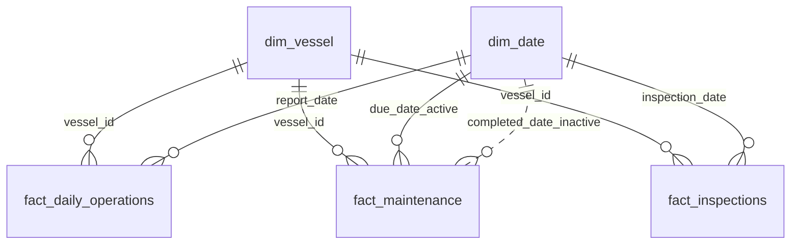

# Zodiac Fleet Performance — Power BI

A Power BI Desktop assessment prototype built from the supplied **synthetic** vessel, daily operations, maintenance and inspection extracts. The report is designed to help a Fleet Performance Manager identify operational trends, maintenance exposure and reporting-quality concerns. The operational snapshot date is **30 June 2026**.

> **Data handling:** Keep this repository **private** because the PBIX contains imported assessment data. Do not upload the supplied Excel workbook or make this repository public.

## How to open the report

1. Download or clone this repository.
2. Open `Zodiac_Fleet_Performance.pbix` in Power BI Desktop.
3. The PBIX contains the imported model and report. If you need to refresh it, open **Transform data → Data source settings** and update the workbook path to the supplied assessment workbook on your own machine.
4. Save the PBIX after any local changes. Do not publish the report or dataset publicly.

This is a **Power BI report**, not a Python web application. A Python `requirements.txt`, `app.yaml`, SQLite persistence layer and app run command are not applicable to this deliverable.

## Business questions

- Which fleets and vessels may need attention, and why?
- How are fuel consumption, CO₂ emissions, distance and downtime changing over time?
- Where are overdue and high-priority maintenance orders concentrated?
- How complete and trustworthy is the underlying reporting?

## Report guide and status

### Fleet Overview

The current PBIX includes a Fleet Overview page with KPI cards for fuel consumed, CO₂ emissions, distance sailed, overdue work orders, downtime rate and reporting completeness; a monthly fuel-consumption line chart; a vessel Attention Score ranking; and slicers for Fleet, Vessel Type, Vessel and Date.

Use the slicers to restrict the visuals to the chosen fleet, vessel type, vessel or date range. The attention score is an assumption-based triage aid, not a validated maritime risk model.

**Status note:** The current screenshot and working report show the Fleet Overview page. The original Power BI brief also requests Vessel Detail, Maintenance Risk, and Data Quality & Trust pages. Treat those pages as pending unless they are present and tested in the submitted PBIX. Do not describe the full four-page experience as complete otherwise.

## Data and transformation approach

The supplied workbook provides four operational areas:

| Source sheet         | Contents                                                                                   |
| -------------------- | ------------------------------------------------------------------------------------------ |
| `vessels`            | Vessel key/name, fleet, type, office, commissioning date, management status and deadweight |
| `daily_operations`   | Report date/status, distance, steaming hours, fuel, CO₂, downtime and average speed        |
| `maintenance_orders` | Work orders, due/completion dates, status, priority, estimated cost and maintenance type   |
| `inspections`        | Inspection date/type, port, deficiencies, detention, condition score and finding status    |

Power Query keeps the four raw queries as non-loaded source queries and creates transformed reporting queries: `dim_vessel`, `fact_daily_operations`, `fact_maintenance`, `fact_inspections` and `DataQuality`. The helper functions `fxSafeDate` and `fxSafeNumber` make conversions repeatable and handle invalid values without directly editing the workbook.

### Data-quality rules and assumptions

- **Snapshot date:** 30 June 2026 is fixed for reproducible historical status; calculations should not move with `TODAY()`.
- **Duplicates:** Identified duplicate operation copies are retained with flags and excluded from the relevant KPI calculations. Duplicate identifiers in the other areas should be investigated rather than silently removed.
- **Orphan vessel IDs:** Retained and flagged; excluded from vessel-attributed KPIs because no valid vessel master match exists.
- **Missing-status reports:** Records labelled `Missing` are excluded from default operational totals even if they contain metric values. Such populated values remain visible for investigation.
- **Metric-specific exclusions:** Negative fuel is excluded from fuel totals; null CO₂ is excluded from CO₂ totals; negative or implausible speed is excluded from speed; invalid/negative values should not be silently included in the affected measures.
- **Speed threshold:** Values below zero or above 40 knots are flagged for review. The 40-knot threshold is an assessment assumption, not an approved maritime operating limit.
- **CO₂/fuel validation:** A ratio near 3.114 with a ±5% tolerance is used only as a quality flag. Values are not auto-corrected.
- **Maintenance overdue:** An order is overdue if it was not completed on or before 30 June 2026 and has a valid due date strictly earlier than 30 June 2026. A due date of 30 June is not overdue under this rule. The derived snapshot status is used instead of relying solely on the stored status.
- **Maintenance cost:** Null costs stay unknown. Costs greater than three times the observed median are flagged for investigation but not automatically excluded.
- **Inspections:** `v014` is standardised to `V014`; `Y`/`Yes` detention values are standardised. Condition scores outside 0–100 are flagged and excluded from the valid-score average.
- **Managed vs External:** External vessels are retained. KPI scope should be explicit where a managed-only view is required.
- **Missing vessel-days:** A missing vessel/date pair is not the same as an existing row labelled `Missing`; no missing operational values are fabricated.

Issue counts can overlap because one record can trigger more than one rule.

## Semantic model

The intended model is a star schema: `dim_vessel` filters each operational fact table, while `dim_date` filters dated facts. `DataQuality` is a disconnected issue-summary table for the data-quality view.

The maintenance relationship to `due_date` is active; the relationship to `completed_date` is inactive and should be activated in measures with `USERELATIONSHIP()` when analysing completions by completion date. Relationships use standardised vessel IDs and single-direction dimension-to-fact filtering.

## Measure dictionary

Measures are stored in `_Measures`. Core definitions:

| Measure                        | Meaning                                                                                                                                                                                      |
| ------------------------------ | -------------------------------------------------------------------------------------------------------------------------------------------------------------------------------------------- |
| `Distance (nm)`                | Sum of distance-eligible records, in nautical miles                                                                                                                                          |
| `Fuel Consumed (mt)`           | Sum of fuel-eligible records, in metric tonnes                                                                                                                                               |
| `CO2 Emissions (mt)`           | Sum of CO₂-eligible records, in metric tonnes                                                                                                                                                |
| `Fuel per NM`                  | Eligible fuel divided by compatible eligible distance; zero-distance rows are excluded from the ratio                                                                                        |
| `CO2 per NM`                   | Eligible CO₂ divided by compatible eligible distance                                                                                                                                         |
| `Avg Speed (knots)`            | Distance-weighted average of eligible daily speeds                                                                                                                                           |
| `Downtime Hours`               | Sum of downtime-eligible hours                                                                                                                                                               |
| `Downtime %`                   | Eligible downtime / (eligible downtime + eligible steaming hours); assessment definition, not a confirmed company standard                                                                   |
| `Expected Vessel-Days`         | Vessels in filter scope multiplied by calendar dates selected                                                                                                                                |
| `Reporting Completeness %`     | Submitted plus Late reports divided by expected vessel-days; interpret alongside explicit Missing statuses and absent vessel-days                                                            |
| `On-time %` / `Late %`         | Submitted or Late reports divided by Submitted + Late reports                                                                                                                                |
| `Missing %`                    | One minus reporting completeness; includes gaps in expected reporting coverage                                                                                                               |
| `Records Excluded by DQ Rules` | Operation rows whose base KPI eligibility flag is false                                                                                                                                      |
| `Open WOs` / `Overdue WOs`     | Work orders classified using date-derived status at 30 June 2026                                                                                                                             |
| `Overdue Critical+High WOs`    | Overdue work orders with Critical or High priority                                                                                                                                           |
| `Avg Days Overdue`             | Average days from due date to the fixed snapshot date for overdue orders                                                                                                                     |
| `Maintenance Cost at Risk`     | Estimated eligible cost on overdue orders; unknown costs excluded, outliers retained pending review                                                                                          |
| `Inspections`                  | Count of inspection rows marked KPI-eligible                                                                                                                                                 |
| `Avg Deficiencies`             | Average of nonnegative deficiency counts on eligible inspection rows                                                                                                                         |
| `Detention Rate`               | Detained inspections divided by inspections with valid Yes/No detention values                                                                                                               |
| `Avg Condition Score`          | Average eligible score in the 0–100 range                                                                                                                                                    |
| `Open Findings`                | Counts eligible inspection records with finding status Open or In Progress; verify whether inspection grain equals finding grain before operational interpretation                           |
| `Attention Score`              | Weighted triage score combining overdue high/critical orders, all overdue orders, detention, open findings and downtime; weights are assumptions and must be reviewed before operational use |

## Local interaction and validation

- Use Fleet, Vessel Type, Vessel and Date slicers to filter the overview.
- The monthly fuel trend is intended to show changes across the selected date range.
- The Attention Score chart ranks vessels; it is a prioritisation aid, not a safety classification.
- Validate the displayed KPIs against the selected filters and check all quality flags before drawing conclusions.
- The PBIX currently documents the overview interaction. Do not claim a chart-to-detail table selection or drill-through is implemented unless it has been tested in the submitted file.

## Limitations and next steps

1. Complete and test the remaining required pages: Vessel Detail, Maintenance Risk, and Data Quality & Trust.
2. Test all slicers, cross-filter interactions and vessel drill-through.
3. Verify KPI totals and denominators, especially reporting completeness and expected vessel-day scope.
4. Use `USERELATIONSHIP()` for measures grouped by maintenance completion date.
5. Review the assumed speed threshold, CO₂/fuel tolerance, cost-outlier threshold and Attention Score weights with stakeholders.
6. Add month-over-month and rolling 30-day measures where time permits; document UAT results.

## Interview preparation

**Why a star schema?** It keeps vessel/date dimensions separate from facts, makes filter propagation predictable and supports reusable measures.

**Why a fixed as-of date?** It makes historical overdue classification reproducible and avoids results changing over time.

**Why flag rather than delete bad rows?** It preserves auditability and makes data-quality impact visible. Eligibility is metric-specific so a bad fuel value does not necessarily invalidate distance or inspection data.

**How is overdue maintenance defined?** Not completed by 30 June 2026, with a valid due date strictly earlier than that date.

**What does completeness mean?** Submitted plus Late reports divided by expected vessel-days. Explicit Missing rows and absent vessel-days are different states.

**Why distance-weighted speed?** It avoids giving a short-distance day the same influence as a long-distance day, while still requiring operating-context caveats.

**How should Attention Score be used?** As an explainable triage aid with explicit assumptions, not a validated maritime risk model.

**What would you improve next?** Finish and test all required pages, validate KPI definitions with stakeholders, improve missing-coverage reporting and document UAT.

## Repository contents

- `Zodiac_Fleet_Performance.pbix` — Power BI Desktop report (add this file before submission).
- `README.md` — project and implementation notes.
- `.gitignore` — ignores common temporary/system files.
- `fleet-overview.png` — overview screenshot (optional preview).
